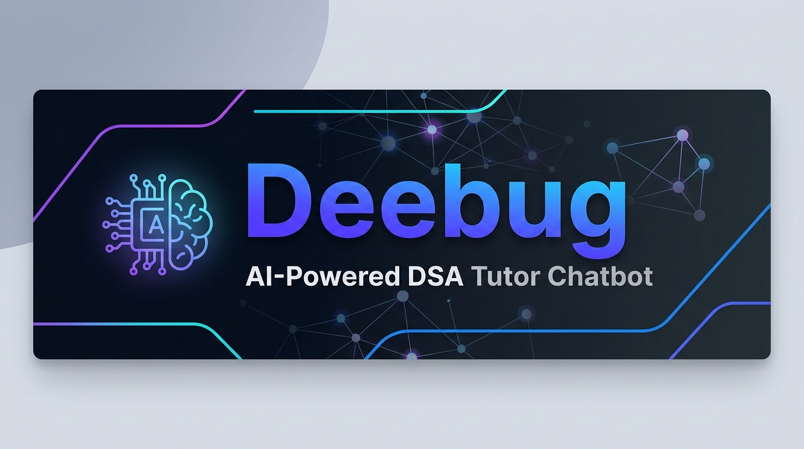

<div align="center">
  
  
  <br/>

  <p>
    
    
    
    
    
    
  </p>

  <p>
    <strong>An intelligent DSA tutoring system that teaches through guided discovery — never by revealing solutions.</strong>
  </p>

  <p>
    <a href="#-features">Features</a> •
    <a href="#-dsa-sheet--mnc-filters">DSA Sheet & Company Filters</a> •
    <a href="#-architecture">Architecture</a> •
    <a href="#-tech-stack">Tech Stack</a> •
    <a href="#-quick-start">Quick Start</a> •
    <a href="#-api-reference">API Reference</a> •
    <a href="#-project-structure">Project Structure</a>
  </p>
</div>

---

## 🎯 What is Deebug?

**Deebug** is a full-stack AI chatbot and structured practice platform engineered to act as your personal DSA (Data Structures & Algorithms) tutor. Unlike a simple code generator, Deebug is built to **teach, not cheat** — it uses a multi-stage AI pipeline to provide Socratic-style guidance, hints, and conceptual explanations without ever writing code for you.

> 💡 **Philosophy**: The best way to master DSA is to struggle productively. Deebug keeps you in that sweet spot — challenged, supported, but never handed the answer.

**Key highlights:**
- 🧠 **LangGraph-powered AI pipeline** with 11 interconnected nodes
- 🛡️ **5-layer safety system** that actively prevents code leakage
- ⚡ **Real-time SSE token streaming** for a natural, typing-effect response
- 📚 **A2Z-Style DSA Problem Sheet** with curated topic roadmaps and progress tracking
- 🏢 **MNC Company Filter** covering top interview questions from Amazon, Google, Meta, Microsoft, Apple, Netflix, Uber, Bloomberg, Adobe
- 🎨 **Modern Orange & White Theme** designed for long study sessions with crisp contrast and zero clutter
- 💻 **Integrated Code Editor & Code Runner** with custom input testing
- 📊 **LeetCode problem bank (2,900+ problems)** with semantic RAG concept retrieval

---

## ✨ Features

| Feature | Description |
|---|---|
| 🤖 **Smart Intent Classifier** | Detects if you're asking for a concept, hint, code review, debugging help, or trying to extract a solution |
| 🚫 **Anti-Cheat Engine** | 5-layer pipeline ensuring the AI never gives away code or answers directly |
| 💬 **Streaming Responses** | Answers stream token-by-token via Server-Sent Events (SSE) for a fluid UX |
| 📚 **A2Z DSA Problem Sheet** | Structured topic roadmaps (Arrays, Linked Lists, Trees, DP, Graphs) with completion tracking |
| 🏢 **MNC Company Filter** | Filter problems asked in interviews by Amazon, Google, Meta, Microsoft, Apple, Netflix, Uber, Bloomberg, Adobe |
| 🏷️ **Collapsible Meta Tags** | Clean header pills for `Topics ▾` and `Companies ▾` showing question tags and company interview history |
| 🔍 **RAG Context Injection** | Retrieves relevant DSA concepts from vector embeddings to enrich explanations |
| 📝 **Notepad & Revision** | Keep personal notes per problem and star questions for quick revision |
| 🖥️ **Code Runner & Editor** | Monaco-powered editor with syntax highlighting, language selection, and execution against custom inputs |
| ⭐ **Feedback System** | Rate AI responses to continuously improve tutoring quality |

---

## 📚 DSA Sheet & MNC Filters

The platform includes a dedicated **DSA Problem Sheet** (`/sheet`) modeled after top-tier interview roadmaps:

### 1. Topic Roadmaps
Problems are organized into progressive topics:
- **Learn the Basics** (Syntax, Math, Basic Recursion)
- **Arrays & Hashing** (Sliding Window, Prefix Sums, Two Pointers)
- **Binary Search** (1D Arrays, Answer Space, Rotated Arrays)
- **Strings** (Palindromes, Anagrams, String Matching)
- **Linked Lists** (Singly, Doubly, Fast & Slow Pointers)
- **Recursion & Backtracking** (Subsets, Combinations, Permutations)
- **Bit Manipulation** (Bitwise Tricks, Submasks)
- **Stacks & Queues** (Monotonic Stack, Sliding Window Max)
- **Trees & Binary Search Trees** (Traversals, LCA, Views)
- **Graphs** (BFS, DFS, Dijkstra, Topo Sort, Disjoint Set)
- **Dynamic Programming** (1D, 2D, DP on Trees/Stocks, Digit DP)
- **Tries, Heaps & Advanced** (Priority Queues, Segment Trees)

### 2. MNC Company Question Filtering
Directly filter questions asked in technical interviews by top tech MNCs with live question counters:
- 🛍️ **Amazon (AMZN)**
- 🔍 **Google (GOOG)**
- 🌐 **Meta (META)**
- 💻 **Microsoft (MSFT)**
- 🍎 **Apple (AAPL)**
- 🎬 **Netflix (NFLX)**
- 🚗 **Uber (UBER)**
- 📊 **Bloomberg (BLMB)**
- 🎨 **Adobe (ADBE)**

Each problem row features company badges (e.g. `AMZN`, `GOOG`, `META`) and single-click row navigation to jump straight into practice.

---

## 🏗️ Architecture

```
                        ┌─────────────────────────────────────────────────┐
                        │              User (Browser)                     │
                        │     Next.js 14 Frontend (App Router)            │
                        │  [/ - Problem Editor]    [/sheet - DSA Sheet]   │
                        └────────────────────┬────────────────────────────┘
                                             │ SSE Stream / REST API
                        ┌────────────────────▼────────────────────────────┐
                        │           Express.js REST API                   │
                        │        (Node.js + TypeScript)                   │
                        └────────────────────┬────────────────────────────┘
                                             │
                        ┌────────────────────▼────────────────────────────┐
                        │          LangGraph Tutor Pipeline               │
                        │                                                 │
                        │  ┌─────────────────────────────────────────┐   │
                        │  │         Intent Classifier               │   │
                        │  │  (concept / hint / debug / rejected /   │   │
                        │  │       off_topic / code_review)          │   │
                        │  └──────┬──────────────┬───────────────────┘   │
                        │         │              │                        │
                        │  ┌──────▼──────┐  ┌───▼────────┐              │
                        │  │  Off-Topic  │  │ Rejection  │              │
                        │  │    Node     │  │   Setup    │              │
                        │  └──────┬──────┘  └───┬────────┘              │
                        │         │              │                        │
                        │         │        ┌─────▼────────────┐          │
                        │         │        │ Context Injector │          │
                        │         │        │   (FAISS RAG)    │          │
                        │         │        └─────┬────────────┘          │
                        │         │              │                        │
                        │         │        ┌─────▼────────────┐          │
                        │         │        │  Prompt Builder  │          │
                        │         │        └─────┬────────────┘          │
                        │         │              │                        │
                        │         │        ┌─────▼────────────┐          │
                        │         │        │   Teacher LLM    │          │
                        │         │        │  (Groq / Gemini) │          │
                        │         │        └─────┬────────────┘          │
                        │         │              │                        │
                        │         │   ┌──────────▼──────────────────┐   │
                        │         │   │      5-Layer Safety System   │   │
                        │         │   │  1. Intent block (input)     │   │
                        │         │   │  2. System prompt rules      │   │
                        │         │   │  3. Regex (50+ patterns)     │   │
                        │         │   │  4. Heuristic analysis       │   │
                        │         │   │  5. Judge LLM (AI reviewer)  │   │
                        │         │   └──────────┬──────────────────┘   │
                        │         │              │                        │
                        │         │        ┌─────▼────────────┐          │
                        │         │        │Response Formatter│          │
                        │         │        └─────┬────────────┘          │
                        │         │              │                        │
                        │  ───────┴──────────────┘                       │
                        └─────────────────┬───────────────────────────── ┘
                                          │ Token stream
                                 ┌────────▼────────┐
                                 │   SQLite (via   │
                                 │   Prisma ORM)   │
                                 └─────────────────┘
```

### 🛡️ 5-Layer Safety System

Deebug enforces a defense-in-depth model to maintain educational integrity:

| Layer | Mechanism | Stage |
|---|---|---|
| **1. Intent Classification** | LLM-based intent detection flags `REJECTED` requests before responses generate | Input |
| **2. System Prompt Rules** | Strict Socratic instructions injected into every prompt prohibiting code outputs | Prompt |
| **3. Regex Detection** | 50+ patterns identifying function definitions, complete loops, and language syntax | Output |
| **4. Heuristic Analysis** | Structural checks: semicolon density, brace ratios, indentation syntax | Output |
| **5. Judge LLM** | Independent secondary AI auditor reviews generated responses for solution leakage | Output |

---

## 🛠️ Tech Stack

<table>
  <thead>
    <tr>
      <th>Layer</th>
      <th>Technology</th>
      <th>Purpose</th>
    </tr>
  </thead>
  <tbody>
    <tr>
      <td><strong>Frontend</strong></td>
      <td>Next.js 14, TypeScript, TailwindCSS</td>
      <td>App Router, SSE streaming UI, Monaco Editor, Lucide icons</td>
    </tr>
    <tr>
      <td><strong>Backend</strong></td>
      <td>Node.js, Express.js, TypeScript</td>
      <td>REST API, SSE streaming endpoints, code execution, rate limiting</td>
    </tr>
    <tr>
      <td><strong>AI Orchestration</strong></td>
      <td>LangChain.js, LangGraph.js</td>
      <td>Stateful multi-node tutor pipeline</td>
    </tr>
    <tr>
      <td><strong>LLM (Teacher)</strong></td>
      <td>Groq (LLaMA / DeepSeek R1) & Gemini 2.5 Flash</td>
      <td>Ultra-low latency inference for Socratic tutoring</td>
    </tr>
    <tr>
      <td><strong>LLM (Classifier & Judge)</strong></td>
      <td>Google Gemini 2.5 Flash / 1.5 Flash</td>
      <td>Intent classification & safety review</td>
    </tr>
    <tr>
      <td><strong>RAG / Vector DB</strong></td>
      <td>FAISS (faiss-node) & Transformers</td>
      <td>Semantic search over DSA concept embeddings</td>
    </tr>
    <tr>
      <td><strong>Database</strong></td>
      <td>SQLite + Prisma ORM</td>
      <td>Chat sessions, message history, feedback</td>
    </tr>
    <tr>
      <td><strong>Logging</strong></td>
      <td>Winston</td>
      <td>Structured JSON logging across services</td>
    </tr>
    <tr>
      <td><strong>Validation</strong></td>
      <td>Zod</td>
      <td>Runtime schema validation</td>
    </tr>
  </tbody>
</table>

---

## 🚀 Quick Start

### Prerequisites

- **Node.js** v18 or higher
- **npm** v9+
- A **Google AI Studio** API key ([get one here](https://aistudio.google.com/))
- A **Groq** API key ([get one here](https://console.groq.com/))

### 1. Clone the Repository

```bash
git clone https://github.com/anuragsinghmusics-wq/AI-DSA-CHATBOT-TUTOR.git
cd AI-DSA-CHATBOT-TUTOR
```

### 2. Configure Environment Variables

```bash
cp .env.example backend/.env
```

Open `backend/.env` and supply your API keys:

```env
# Server
PORT=3001
NODE_ENV=development
CORS_ORIGIN=http://localhost:3000

# Database
DATABASE_URL=file:./dev.db

# AI Keys
GOOGLE_API_KEY=your_google_gemini_api_key_here
GROQ_API_KEY=your_groq_api_key_here

# Rate Limiting
RATE_LIMIT_WINDOW_MS=60000
RATE_LIMIT_MAX_REQUESTS=30
```

### 3. Set Up the Backend

```bash
cd backend
npm install

# Push database schema
npx prisma db push

# Start the dev server
npm run dev
```

The backend starts at **http://localhost:3001**.

### 4. Set Up the Frontend

In a separate terminal window:

```bash
cd frontend
npm install
npm run dev
```

The frontend runs at **http://localhost:3000**.

### 5. Access the Platform

- **Problem Editor & AI Tutor**: [http://localhost:3000](http://localhost:3000)
- **DSA Problem Sheet & MNC Filters**: [http://localhost:3000/sheet](http://localhost:3000/sheet)

---

## 📡 API Reference

Base URL: `http://localhost:3001`

### Chat & Tutoring

| Method | Endpoint | Description |
|---|---|---|
| `POST` | `/api/chat` | Send message — returns a **Server-Sent Events (SSE)** token stream |
| `GET` | `/api/chat/history/:sessionId` | Retrieve full chat history for a session |
| `DELETE` | `/api/chat/history/:sessionId` | Clear chat session history |
| `POST` | `/api/chat/feedback` | Submit thumbs up/down rating and comments |

### Problems & Execution

| Method | Endpoint | Description |
|---|---|---|
| `GET` | `/api/problems` | List problems with tags, difficulty, and company associations |
| `GET` | `/api/problems/:id` | Fetch full problem context, constraints, examples, and snippets |
| `POST` | `/api/run` | Execute user code with custom inputs and return runtime output |

---

## 📁 Project Structure

```
AI-DSA-CHATBOT-TUTOR/
├── 📂 frontend/                          # Next.js 14 Frontend
│   └── src/
│       ├── app/
│       │   ├── page.tsx                  # Main Problem Editor & AI Tutor
│       │   ├── sheet/                    # A2Z DSA Sheet (/sheet)
│       │   ├── layout.tsx                # App layout & font setup
│       │   └── globals.css               # Orange/White design system
│       ├── components/
│       │   ├── chat/                     # ChatPanel, ChatMessage, ChatInput
│       │   ├── problem/                  # ProblemView, CodeEditor, NotepadView
│       │   ├── sheet/                    # DSASheetPage, TopicSection, ProblemRow, DSAProgressPanel
│       │   └── layout/                   # AppLayout, navigation headers
│       ├── hooks/                        # useChat, useProgress, useNotepad
│       ├── lib/                          # api.ts, sheetData.ts, companyData.ts
│       └── types/                        # Shared TypeScript interfaces
│
└── 📂 backend/                           # Express.js API Server
    ├── prisma/
    │   └── schema.prisma                 # Database models
    └── src/
        ├── ai/
        │   ├── graph/                    # 11 LangGraph nodes & workflow pipeline
        │   ├── prompts/                  # System, Teacher, Judge & Intent prompts
        │   ├── safety/                   # 50+ Regex patterns & heuristics
        │   └── llm/                      # Gemini & Groq client factories
        ├── config/                       # Environment & DB configuration
        ├── controllers/                  # Chat, Problem & Code Run controllers
        ├── data/                         # companyData.ts (MNC question mappings)
        ├── repositories/                 # LeetCode parser & problem repository
        ├── routes/                       # Express route definitions
        ├── services/                     # ChatService, ProblemService, RAGService
        └── utils/                        # Winston logger
```

---

## 🤝 Contributing

1. Fork the repository
2. Create your branch (`git checkout -b feature/amazing-feature`)
3. Commit your changes (`git commit -m 'feat: add amazing feature'`)
4. Push to branch (`git push origin feature/amazing-feature`)
5. Open a Pull Request

---

## 📜 License

Distributed under the **MIT License**. See [LICENSE](./LICENSE) for details.

<div align="center">
  <p>Built with ❤️ to master Data Structures & Algorithms the right way.</p>
</div>
