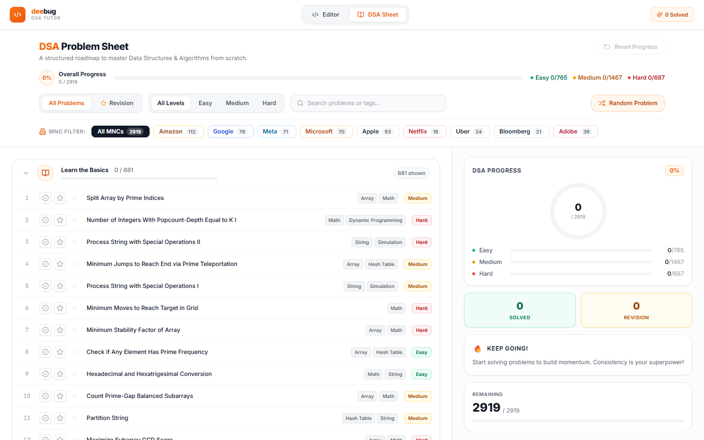
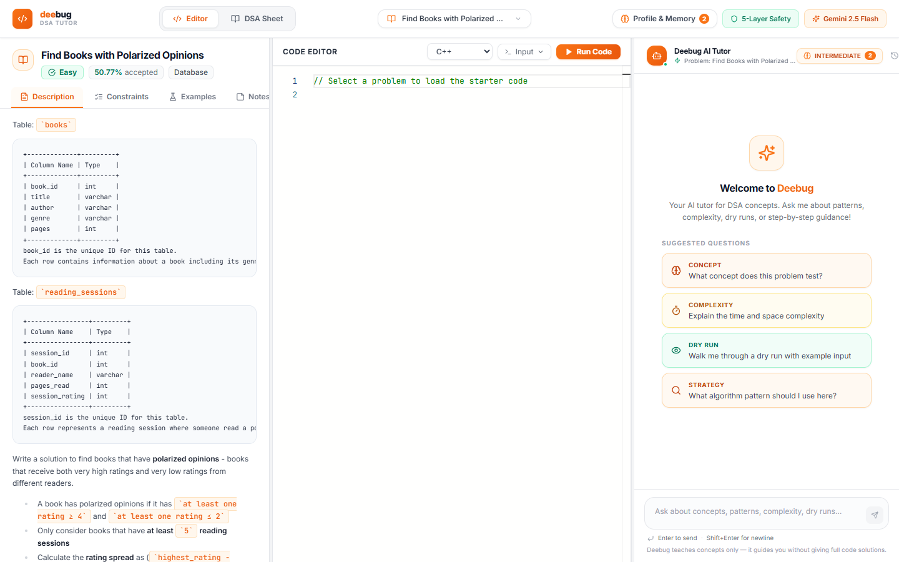

<div align="center">
  
  
  <br/>

  <p>
    
    
    
    
    
    
  </p>

  <p>
    <strong>An intelligent, personalized DSA tutoring system that teaches through guided discovery — with Long-Term Memory, Multi-Session Chat, and Anti-Leak Safety.</strong>
  </p>

  <p>
    <a href="#-screenshots">Screenshots</a> •
    <a href="#-features">Features</a> •
    <a href="#-long-term-memory--personalization">Long-Term Memory</a> •
    <a href="#-dsa-sheet--mnc-filters">DSA Sheet & Company Filters</a> •
    <a href="#-architecture">Architecture</a> •
    <a href="#-tech-stack">Tech Stack</a> •
    <a href="#-quick-start">Quick Start</a> •
    <a href="#-api-reference">API Reference</a>
  </p>
</div>

---

## 🎯 What is Deebug?

**Deebug** is a full-stack AI chatbot and structured practice platform engineered to act as your personal DSA (Data Structures & Algorithms) tutor. Unlike generic code generators that rob you of learning, Deebug is built to **teach, not cheat** — it uses a multi-stage LangGraph AI pipeline to provide Socratic-style guidance, dry runs, and conceptual hints without ever writing direct code solutions for you.

> 💡 **Philosophy**: The best way to master DSA is to struggle productively. Deebug keeps you in that sweet spot — challenged, supported, and guided, but never handed the answer.

### Key Highlights:
- 🧠 **LangGraph-Powered AI Pipeline**: 11 stateful nodes orchestrating intent analysis, RAG context, safety filters, and Socratic responses.
- 🧬 **Persistent Long-Term Memory (LTM)**: Remembers your name, background, preferred language, recurring misconceptions, strengths, and milestones across all chats and problems.
- 💬 **Multi-Session Chat History & "New Chat"**: Archived conversation drawer with instant session switching, previews, and persistent local storage.
- 🛡️ **5-Layer Anti-Leak Safety System**: Input classification, strict system prompt rules, 50+ regex patterns, heuristic density checks, and a secondary Judge LLM auditor.
- 📚 **A2Z-Style DSA Problem Sheet**: Master roadmaps (Arrays, Trees, Graphs, DP) as the primary landing page with progress tracking, difficulty filters, and search.
- 🏢 **MNC Company Filter**: Curated tags for interview questions asked at Amazon, Google, Meta, Microsoft, Apple, Netflix, Uber, Bloomberg, and Adobe.
- 💻 **Integrated Code Editor & Runner**: Monaco-powered workspace with syntax highlighting, custom input testing, and instant language switching.
- ⚡ **Real-Time SSE Streaming**: Token-by-token streaming with typing effects for an authentic one-on-one tutoring feel.

---

## 📸 Screenshots

### 1. DSA Problem Sheet (Landing Page — `/`)
A structured problem sheet with live progress statistics, difficulty filters, MNC company tags, and topic-wise roadmaps:

<div align="center">
  
</div>

<br/>

### 2. Interactive Problem Editor & AI Tutor (`/editor`)
Split-pane coding workspace with problem details, Monaco editor, custom testcase execution, and the Socratic AI Chatbot:

<div align="center">
  
</div>

---

## ✨ Features

| Feature | Description |
|---|---|
| 🧠 **Long-Term Memory (LTM)** | Automatically captures student name, goals, blind spots, and milestones to personalize every session |
| 👤 **Learner Profile & Memory Modal** | Manage personal info, skill level (Beginner/Intermediate/Advanced), target language, and custom memory notes |
| 🗂️ **Multi-Session Chat & New Chat** | Start fresh conversations per problem while preserving past chat sessions in a slide-in drawer |
| 🔄 **URL & Refresh Persistence** | Switching problems syncs the URL query string; page refresh retains active problem and chat context |
| 🤖 **Smart Intent Classifier** | Distinguishes concepts, dry runs, debugging, complexity analysis, code reviews, and solution requests |
| 🚫 **5-Layer Anti-Leak Safety** | Guarantees educational integrity by blocking full code dumps and guiding students through logic |
| 📚 **A2Z DSA Problem Sheet** | Structured roadmaps across 2,900+ LeetCode problems with completion & revision tracking |
| 🏢 **MNC Company Filter** | Filter problems asked in top tech company interviews (Amazon, Google, Meta, Microsoft, etc.) |
| 💬 **Token-by-Token SSE Stream** | Server-Sent Events deliver conversational responses with real-time markdown and syntax formatting |
| 🖥️ **Monaco Code Editor & Runner** | In-browser coding workspace with multi-language support (C++, Python, Java, JavaScript) and custom input runs |
| 📝 **Problem Notepad** | Save persistent personal notes and revision tags per problem |

---

## 🧬 Long-Term Memory & Personalization

Deebug is designed around a **User-Oriented Memory Architecture** that persists across different chat sessions, problem switches, and page refreshes:

```
┌────────────────────────────────────────────────────────────────────────┐
│                        User Introduces Themselves                      │
│                e.g. "Hi, my name is Harsh and I prefer C++"            │
└───────────────────────────────────┬────────────────────────────────────┘
                                    │
        ┌───────────────────────────┴───────────────────────────┐
        ▼                                                       ▼
┌───────────────────────────────┐       ┌───────────────────────────────┐
│     Immediate Name Detector   │       │   Background Reflection LLM   │
│   - Detects name instantly    │       │   - Extracts learning styles  │
│   - Updates Prisma User record│       │   - Discovers misconceptions  │
│   - Immediately available     │       │   - Records milestones        │
└───────────────┬───────────────┘       └───────────────┬───────────────┘
                │                                       │
                └───────────────────┬───────────────────┘
                                    │
                                    ▼
┌────────────────────────────────────────────────────────────────────────┐
│               SQLite Persistent Long-Term Memory (LTM)                │
│    - UserProfile: name, skillLevel, preferredLanguage, learningGoals   │
│    - UserMemory: [LEARNING_STYLE], [WEAKNESS], [STRENGTH], [MILESTONE] │
└───────────────────────────────────┬────────────────────────────────────┘
                                    │ Injected into every prompt
                                    ▼
┌────────────────────────────────────────────────────────────────────────┐
│                          Teacher LLM Tutor                             │
│   "Hello Harsh! I remember you prefer C++. Let's look at Two Sum..."   │
└────────────────────────────────────────────────────────────────────────┘
```

- **Identity Awareness**: Tells the tutor who you are, addressing you by name and remembering your profile even in brand-new chats on different problems.
- **Pedagogical Calibration**: Explanations adapt automatically to your chosen skill level (Beginner, Intermediate, or Advanced).
- **Proactive Guidance**: Warns you around recurring blind spots (e.g. forgetting recursion base cases or off-by-one errors in binary search).
- **Profile Modal**: Click **"Profile & Memory"** in the top navigation bar to inspect what the AI remembers about you or edit your name, language, and goals anytime.

---

## 🗂️ Multi-Session Chat & "New Chat"

Each problem workspace supports independent, multi-session conversation tracking:

1. **New Chat Button**: Located in the chat header. Click to safely archive your current conversation and start with a clean slate.
2. **Slide-in History Drawer (`🕐`)**: View all past chat sessions for that problem with relative timestamps (e.g., *"10m ago"*), message counts, and first-question previews.
3. **Read-Only Session Review**: Click any past session to inspect previous discussions in a dedicated read-only view with a top banner and easy return to active chat.
4. **Delete Session**: Hover over any archived chat to delete it individually.

---

## 🏗️ Architecture

```
                        ┌─────────────────────────────────────────────────┐
                        │              User (Browser)                     │
                        │     Next.js 14 Frontend (App Router)            │
                        │    [/ - DSA Sheet]    [/editor - Coding Tutor]  │
                        └────────────────────┬────────────────────────────┘
                                             │ SSE Stream / REST API
                        ┌────────────────────▼────────────────────────────┐
                        │           Express.js REST API                   │
                        │        (Node.js + TypeScript)                   │
                        │  - ChatService  - MemoryService  - RunService   │
                        └────────────────────┬────────────────────────────┘
                                             │
                        ┌────────────────────▼────────────────────────────┐
                        │          LangGraph Tutor Pipeline               │
                        │                                                 │
                        │  ┌─────────────────────────────────────────┐   │
                        │  │         Intent Classifier               │   │
                        │  │  (concept / hint / debug / rejected /   │   │
                        │  │       off_topic / code_review)          │   │
                        │  └──────┬──────────────┬───────────────────┘   │
                        │         │              │                        │
                        │  ┌──────▼──────┐  ┌───▼────────┐              │
                        │  │  Off-Topic  │  │ Rejection  │              │
                        │  │    Node     │  │   Setup    │              │
                        │  └──────┬──────┘  └───┬────────┘              │
                        │         │              │                        │
                        │         │        ┌─────▼────────────┐          │
                        │         │        │ Context Injector │          │
                        │         │        │   (FAISS RAG)    │          │
                        │         │        └─────┬────────────┘          │
                        │         │              │                        │
                        │         │        ┌─────▼────────────┐          │
                        │         │        │  Prompt Builder  │          │
                        │         │        │ (+ LTM & Profile)│          │
                        │         │        └─────┬────────────┘          │
                        │         │              │                        │
                        │         │        ┌─────▼────────────┐          │
                        │         │        │   Teacher LLM    │          │
                        │         │        │ (Gemini 3.6 Fl)  │          │
                        │         │        └─────┬────────────┘          │
                        │         │              │                        │
                        │         │   ┌──────────▼──────────────────┐   │
                        │         │   │      5-Layer Safety System   │   │
                        │         │   │  1. Intent block (input)     │   │
                        │         │   │  2. System prompt rules      │   │
                        │         │   │  3. Regex (50+ patterns)     │   │
                        │         │   │  4. Heuristic analysis       │   │
                        │         │   │  5. Judge LLM (AI reviewer)  │   │
                        │         │   └──────────┬──────────────────┘   │
                        │         │              │                        │
                        │         │        ┌─────▼────────────┐          │
                        │         │        │Response Formatter│          │
                        │         │        └─────┬────────────┘          │
                        │         │              │                        │
                        │  ───────┴──────────────┘                       │
                        └─────────────────┬───────────────────────────── ┘
                                          │ Token stream
                                 ┌────────▼────────┐
                                 │   SQLite (via   │
                                 │   Prisma ORM)   │
                                 │  Users, Sessions│
                                 │  Memories, Chats│
                                 └─────────────────┘
```

---

## 🛡️ 5-Layer Safety System

Deebug enforces an educational defense-in-depth model:

| Layer | Mechanism | Stage | Description |
|---|---|---|---|
| **1. Intent Classification** | LLM Classifier | Input | Flags `REJECTED` queries asking directly for code or complete solutions |
| **2. System Prompt Rules** | Socratic Prompting | Prompt | Explicitly instructs the AI to explain logic and ask guiding questions without code output |
| **3. Regex Scanner** | 50+ Pattern Rules | Output | Flags function definitions, loop bodies, class skeletons, and language-specific syntax |
| **4. Heuristic Analyzer** | Statistical Checks | Output | Scans semicolon density, brace ratios, and indentation patterns typical of source code |
| **5. Judge LLM** | Independent Reviewer | Output | Secondary AI evaluates responses flagged by heuristics to confirm or clear code safety |

---

## 🛠️ Tech Stack

<table>
  <thead>
    <tr>
      <th>Layer</th>
      <th>Technology</th>
      <th>Purpose</th>
    </tr>
  </thead>
  <tbody>
    <tr>
      <td><strong>Frontend</strong></td>
      <td>Next.js 14, TypeScript, TailwindCSS</td>
      <td>App Router, SSE streaming UI, Monaco Editor, Lucide icons, responsive drawer</td>
    </tr>
    <tr>
      <td><strong>Backend</strong></td>
      <td>Node.js, Express.js, TypeScript</td>
      <td>REST API, SSE streaming endpoints, code execution, rate limiting</td>
    </tr>
    <tr>
      <td><strong>AI Engine</strong></td>
      <td>Google Gemini 3.6 Flash</td>
      <td>Ultra-low latency reasoning for Teacher, Intent Classifier, Judge, and Memory Reflection</td>
    </tr>
    <tr>
      <td><strong>Orchestration</strong></td>
      <td>LangChain.js, LangGraph.js</td>
      <td>Stateful multi-node tutor pipeline with conditional routing</td>
    </tr>
    <tr>
      <td><strong>RAG / Embeddings</strong></td>
      <td>FAISS (faiss-node) & Transformers</td>
      <td>Semantic search over DSA concept embeddings</td>
    </tr>
    <tr>
      <td><strong>Database & ORM</strong></td>
      <td>SQLite + Prisma ORM</td>
      <td>User profiles, long-term memories, chat sessions, message history, feedback</td>
    </tr>
    <tr>
      <td><strong>Logging</strong></td>
      <td>Winston</td>
      <td>Structured JSON logging across services</td>
    </tr>
  </tbody>
</table>

---

## 🚀 Quick Start

### Prerequisites

- **Node.js** v18 or higher
- **npm** v9+
- A **Google AI Studio** API key ([get one here](https://aistudio.google.com/))

### 1. Clone the Repository

```bash
git clone https://github.com/anuragsinghmusics-wq/AI-DSA-CHATBOT-TUTOR.git
cd AI-DSA-CHATBOT-TUTOR
```

### 2. Configure Environment Variables

Create `backend/.env`:

```env
# Server
PORT=3001
NODE_ENV=development
CORS_ORIGIN=http://localhost:3000

# Database
DATABASE_URL=file:./dev.db

# Google Gemini API Key
GEMINI_API_KEY=your_gemini_api_key_here

# Rate Limiting
RATE_LIMIT_WINDOW_MS=60000
RATE_LIMIT_MAX_REQUESTS=30
```

### 3. Start Backend

```bash
cd backend
npm install
npx prisma db push
npm run dev
```

The backend starts at **http://localhost:3001**.

### 4. Start Frontend

In a second terminal window:

```bash
cd frontend
npm install
npm run dev
```

The frontend starts at **http://localhost:3000**.

### 5. Access the Platform

- **DSA Problem Sheet (Default)**: [http://localhost:3000](http://localhost:3000)
- **Problem Editor & AI Tutor**: [http://localhost:3000/editor](http://localhost:3000/editor)

---

## 📡 API Reference

Base URL: `http://localhost:3001`

### Chat & Tutoring

| Method | Endpoint | Description |
|---|---|---|
| `POST` | `/api/chat` | Send message — returns a **Server-Sent Events (SSE)** token stream |
| `GET` | `/api/chat/history/:sessionId` | Retrieve full chat history for a session |
| `DELETE` | `/api/chat/history/:sessionId` | Clear chat session history |
| `POST` | `/api/chat/feedback` | Submit thumbs up/down rating and comments |

### Learner Profile & Long-Term Memory (LTM)

| Method | Endpoint | Description |
|---|---|---|
| `GET` | `/api/user/profile` | Retrieve active learner profile, user details, and recorded LTM memories |
| `PUT` | `/api/user/profile` | Update learner name, skill level, language, and goals |
| `POST` | `/api/user/memories` | Manually add a learning note / memory for the AI |
| `DELETE` | `/api/user/memories/:id` | Delete an individual memory entry |
| `DELETE` | `/api/user/memories` | Clear all recorded memories for the user |

### Problems & Execution

| Method | Endpoint | Description |
|---|---|---|
| `GET` | `/api/problems` | List problems with tags, difficulty, and company associations |
| `GET` | `/api/problems/:id` | Fetch full problem context, constraints, examples, and snippets |
| `POST` | `/api/run` | Execute user code with custom inputs and return runtime output |

---

## 📁 Project Structure

```
AI-DSA-CHATBOT-TUTOR/
├── 📂 assets/                            # Banner & real app screenshots
│   ├── banner.jpg                        # Project banner
│   ├── sheet-preview.png                 # DSA Sheet screenshot
│   └── editor-preview.png                # Problem Editor & AI Tutor screenshot
│
├── 📂 frontend/                          # Next.js 14 Frontend
│   └── src/
│       ├── app/
│       │   ├── page.tsx                  # DSA Sheet (Default landing page)
│       │   ├── editor/                   # Problem Editor & AI Tutor (/editor)
│       │   ├── sheet/                    # DSA Sheet route (/sheet)
│       │   ├── layout.tsx                # App layout & font setup
│       │   └── globals.css               # Orange/White design system
│       ├── components/
│       │   ├── chat/                     # ChatPanel, ChatMessage, ChatInput
│       │   ├── problem/                  # ProblemView, CodeEditor, NotepadView
│       │   ├── profile/                  # LearnerProfileModal (LTM & Personalization)
│       │   ├── sheet/                    # DSASheetPage, TopicSection, ProblemRow, DSAProgressPanel
│       │   └── layout/                   # AppLayout, navigation headers
│       ├── hooks/                        # useChat (multi-session & persistence), useProgress, useNotepad
│       ├── lib/                          # api.ts, sheetData.ts, companyData.ts
│       └── types/                        # Shared TypeScript interfaces
│
└── 📂 backend/                           # Express.js API Server
    ├── prisma/
    │   ├── dev.db                        # SQLite database
    │   └── schema.prisma                 # User, UserProfile, UserMemory, ChatSession models
    └── src/
        ├── ai/
        │   ├── graph/                    # 11 LangGraph nodes & workflow pipeline
        │   ├── prompts/                  # System, Teacher, Judge & Intent prompts
        │   ├── safety/                   # 50+ Regex patterns & heuristics
        │   └── llm/                      # Gemini client factories (Gemini 3.6 Flash)
        ├── config/                       # Environment & DB configuration
        ├── controllers/                  # Chat, Problem, User & Code Run controllers
        ├── repositories/                 # UserRepository, ChatRepository, ProblemRepository
        ├── routes/                       # Express routes (chat, problem, user, run)
        ├── services/                     # ChatService, MemoryService, ProblemService, RAGService
        └── utils/                        # Winston logger
```

---

## 📜 License

Distributed under the **MIT License**. See [LICENSE](./LICENSE) for details.

<div align="center">
  <p>Built with ❤️ to master Data Structures & Algorithms the right way — guided, personalized, and anti-cheat.</p>
</div>
